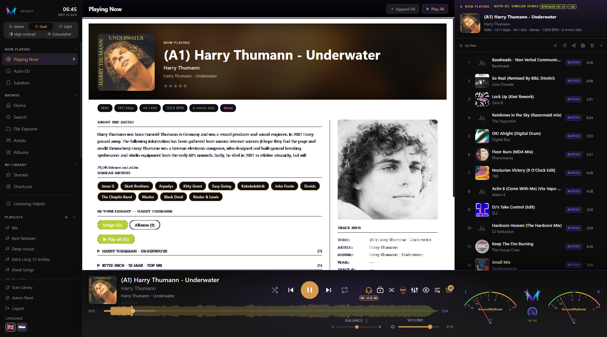
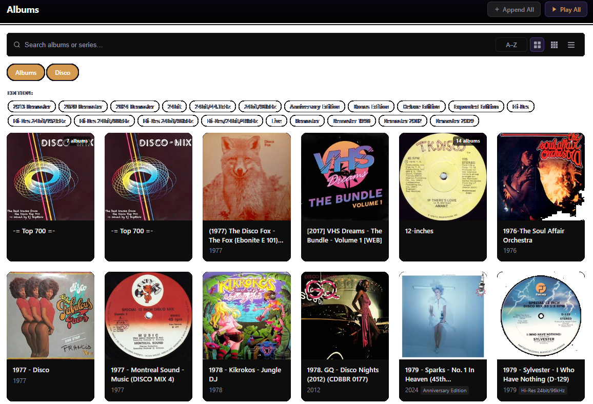
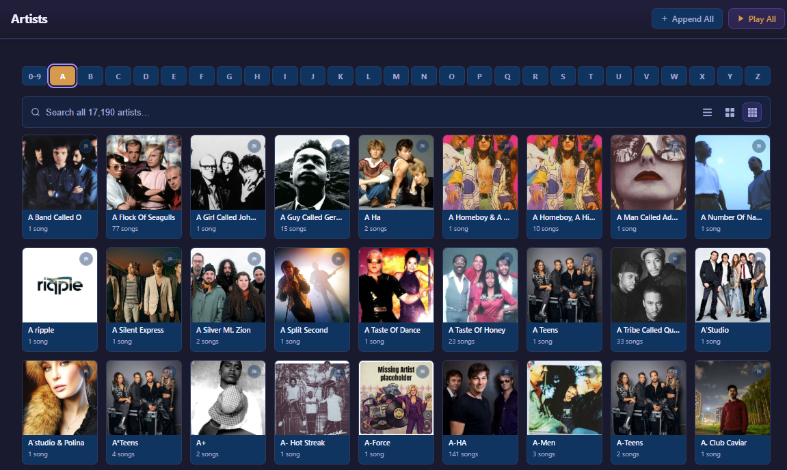
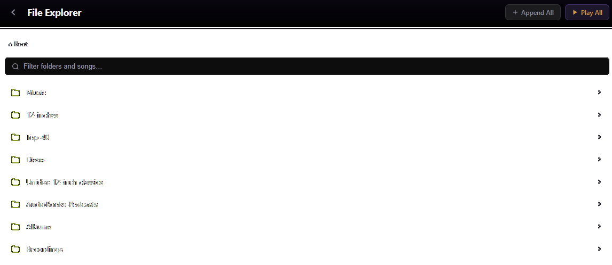
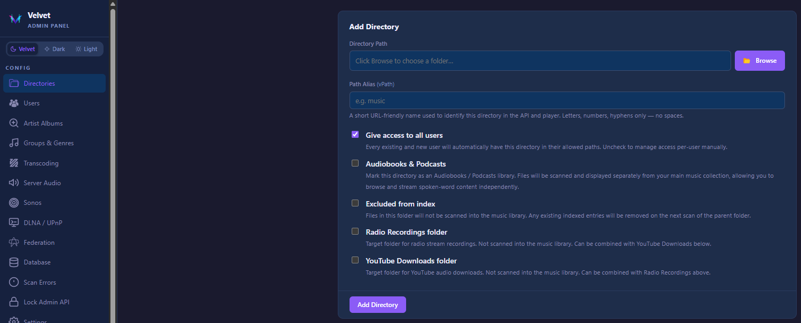
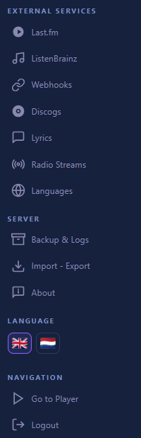
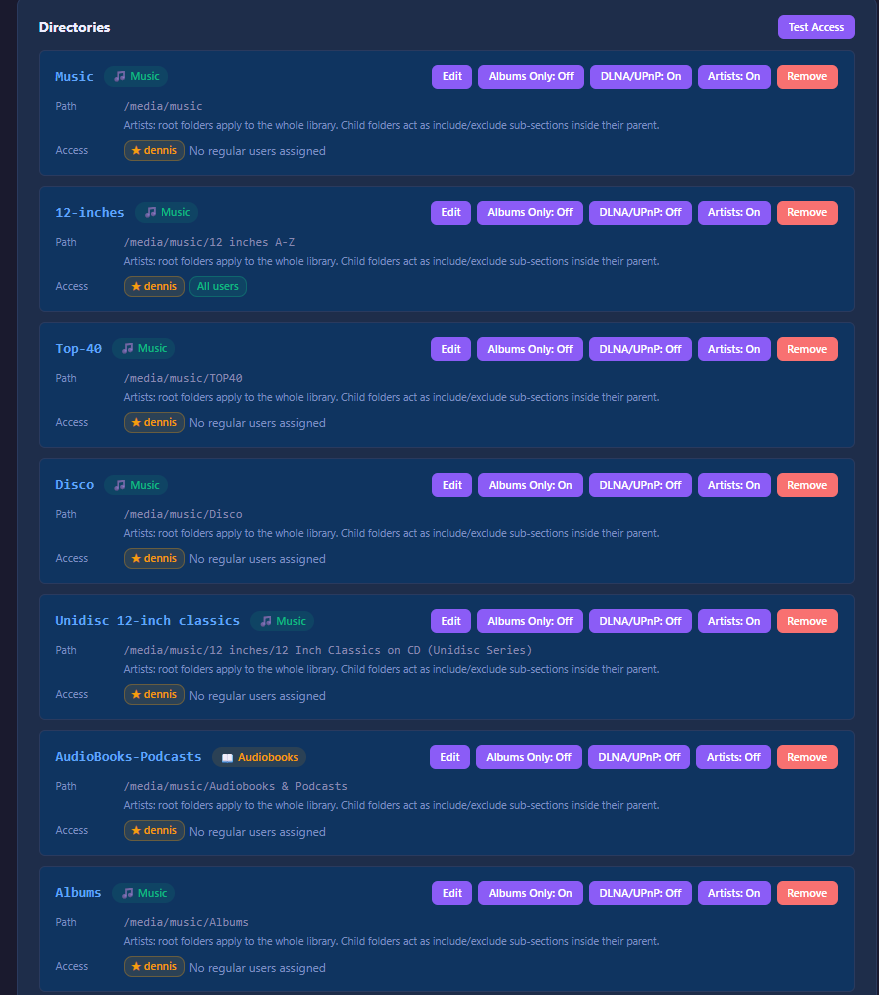
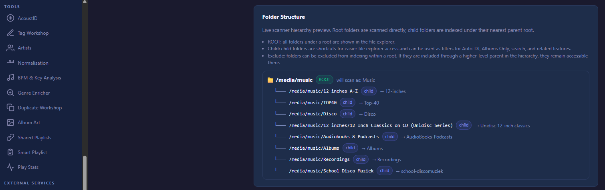

# Velvet

**Your music collection deserves a DJ, not a shuffle button.**

Velvet is a self-hosted music server for people who still own their music. It
streams your library to a browser, a phone, a Samsung TV, Sonos or any
Subsonic app, and to speakers all over the house in sync, which you can also
control from Home Assistant. It plays the way a good DJ would: the next song
follows from the one playing now, tempos move in small steps, keys fit, and
when you want something specific you just say so - *"two hours of 80s italo
that builds up, no Modern Talking"*. No cloud, no subscription, no algorithm
selling you anything.

[](https://github.com/aroundmyroom/Velvet/releases)
[](LICENSE)
[](https://discord.gg/KfsTCYrTkS)
[](https://github.com/aroundmyroom/Velvet/pkgs/container/velvet)
[](docs/lxc-incus.md)
[](https://github.com/aroundmyroom/Velvet/blob/main/docs/tizen-tv.md)
[](docs/home-assistant.md)

> **Before you continue:** This project was built with AI assistance. If that bothers you, the exit is right there. If you're still reading - welcome, you're going to be fine. Probably. [Read the full disclaimer →](docs/responsible-disclosure.md)

---

## What makes it different

**Auto-DJ picks one song at a time.** It doesn't fill a queue once and walk
away. Every next song is chosen against what is playing right now: similar
artists, BPM, Camelot key, genre, era and what you heard recently. So a
session can drift from one style to another without sudden jumps. Change a
filter and you hear it in the very next pick.

**You can just ask for music.** Tell the AI DJ what you want in your own
words and you get a mixed set back, not a list:

> *the top 10 of the House Top 1000* · *one album of Cerrone from around 1985* ·
> *give me the Grandmix 1983 and 1986* · *the most played disco song* ·
> *never played lossless disco from the 70s, no remixes* ·
> *create a mix of 3 songs which match tempo, key and genre*

The model only reads your request. Velvet picks the songs itself from your
library, keeps tempo steps under about 3 BPM, matches keys, never plays a song
twice, and tells you what it did, including when a song exists but sits in a
folder you switched off. It works with Claude or with a model on your own
machine. It's off by default, and reading a library of 140,000 songs costs a
few cents. [How it works](docs/ai-dj.md)

**Messy libraries are fine.** Twenty years of rips, 12-inch collections, radio
megamixes, DJ remix services, box sets, half-tagged folders: that is what
Velvet was built on. Genre Enricher, Album-Art Workshop, AcoustID
fingerprinting and Tag Workshop look things up on Last.fm, MusicBrainz and
Discogs, and you approve every change. Folders numbered by chart position are
read as charts. Multi-disc albums, series and box sets show up the way you'd
expect.

**It plays wherever you are.** Browser and phone, a native Samsung Smart TV
app, Sonos, Sendspin speakers in every room, DLNA, any Subsonic client
(Symfonium, DSub, Ultrasonic), Music Assistant and Home Assistant, and shared
playlist links for friends without an account.

**It plays in every room.** With **Velvet Rooms** your music plays on
speakers around the house, perfectly in sync. It works with speakers and apps
that support the open Sendspin protocol, and your Sonos can play along. Group
speakers into rooms, give each room its own equalizer, and close the browser:
the room keeps playing from a queue on the server. With the **Home Assistant
integration** each room also shows up in Home Assistant, so you can use it in
dashboards, automations, and say *"play Random Access Memories in the
kitchen"*. [Rooms](docs/rooms.md) · [Home Assistant](docs/home-assistant.md)

**It sounds right.** Gapless playback, crossfade, EBU R128 loudness
normalisation with true-peak limiting, transcoding when you need it, an 8-band
EQ, BPM and key analysis of your whole library in the background, and a
full-screen Milkdrop visualizer for when the lights go down.

**It's yours.** One Docker container, one SQLite file, and your music files
stay untouched. HTTPS built in, passkeys, folders per user, listening
statistics that never leave the server, and updates from inside the app.

---

## Quick Start

```shell
docker run -d \
  --name velvet \
  --restart unless-stopped \
  -p 3000:3000 \
  -v ./save:/app/save \
  -v /path/to/your/music:/music \
  -v ./waveform-cache:/app/waveform-cache \
  -v ./image-cache:/app/image-cache \
  ghcr.io/aroundmyroom/velvet:latest
```

Open `http://localhost:3000`, point Velvet at `/music`, and press play. The
scan runs in the background and Auto-DJ works from the first song. Full guides:
[Docker](docs/docker.md) · [bare-metal/systemd](docs/install.md) ·
[Proxmox LXC / Incus](docs/lxc-incus.md) · [reverse proxy](docs/deploy.md).

---

## Look and feel

**Now playing:** the queue, waveform scrubber, album art and all the controls in one view.



<br>

<table>
<tr>
<td width="50%">

**Albums:** multi-disc albums, series and category filters.



</td>
<td width="50%">

**Artists:** photo grid with A–Z navigation, song counts and images from Discogs.



</td>
</tr>
</table>

**File Explorer:** browse by folder, filter, and queue or play any folder.



<br>

<table>
<tr>
<td width="68%">

**Admin, add a folder:** choose what it holds: music, audiobooks, radio recordings or YouTube downloads.



</td>
<td width="32%">

**External services:** Last.fm, ListenBrainz, Discogs, webhooks, radio, lyrics, AI-assist and language.



</td>
</tr>
</table>

<table>
<tr>
<td width="53%">

**Admin, folders:** access per user, DLNA and the folder type for each mount.



</td>
<td width="47%">

**Admin, tools:** AcoustID, Tag Workshop, Genre Enricher, BPM analysis and a preview of the folder structure.



</td>
</tr>
</table>

---

## At a glance

| | |
|---|---|
| **Auto-DJ** | Compares hundreds of songs but only commits to the next one. Each pick is made again from what is playing now: similar artists, BPM, key, genre, era and recent history. [Scoring](docs/autodj-scoring.md) |
| **AI DJ** | Ask for a set, an album, a chart, your most played songs or a three-song harmonic mix. A model reads the request, Velvet picks and mixes the songs. Claude or your own local model, off by default. [Docs](docs/ai-dj.md) |
| **Metadata** | Genre Enricher, Album-Art Workshop, AcoustID and Tag Workshop, using Last.fm, MusicBrainz and Discogs. You approve every change. |
| **Albums** | Multi-disc albums, series, category folders, cover art per disc and CUE sheets. Classical music and box sets look right. |
| **Statistics** | Play history, skip rates, listening by hour, a listener type and fun facts. All of it stays on your server. |
| **Sound** | EBU R128 loudness normalisation, gapless playback, crossfade, BPM and harmonic mixing, transcoding. |
| **Plays everywhere** | Browser, Samsung Smart TV app, Sonos, DLNA/UPnP, Subsonic apps (Symfonium, DSub, Ultrasonic), Music Assistant and shared playlist links. |
| **Velvet Rooms** | Your music in sync on speakers around the house (Sendspin speakers and apps). Rooms keep their own queue on the server and have their own equalizer, Sonos can join a room, and a turntable or AUX input can play in any room. [Docs](docs/rooms.md) |
| **Home Assistant** | Every room is a media player in Home Assistant, with controls, volume, artwork, your library in the media browser and voice through Assist. Install it with HACS from this repository and connect by approving a code. [Docs](docs/home-assistant.md) |
| **12 languages** | EN, NL, DE, FR, ES, IT, PT, PL, RU, ZH, JA, KO, for the player and the admin. |

---

## Features

### Player

- Gapless playback and crossfade (0–5 s)
- ReplayGain / EBU R128 loudness normalisation, per track or per album, with true-peak protection
- Waveform scrubber with chapter markers and buffered range
- 8-band EQ in the browser, and one per Velvet Room on the server
- Choose the audio output device (Chrome/Edge)
- Playback speed for audiobooks (0.75× to 2×)
- Queue with drag to reorder, multi-select and bulk actions
- The queue is kept across page loads and devices
- Keyboard shortcuts for all controls ([list](docs/keyboard-shortcuts.md))
- Command palette (Ctrl+K) to jump to any view or action
- Milkdrop visualizer, full screen and reacting to the music ([credits](#credits))

### Velvet Rooms (multi-room)

Velvet is a Sendspin server: it plays your music on speakers around the
house, perfectly in sync. [Guide](docs/rooms.md)

- **Sendspin speakers and apps.** ESPHome speakers such as the Home Assistant
  Voice Preview Edition and the Connect AUX-2, the reference players for
  Linux, Raspberry Pi, macOS and Windows, and Sendspin for Windows.
- **Rooms.** Every speaker starts as its own room. Group speakers, move them
  while music plays; a speaker that joins late starts in sync.
- **Queue on the server.** Choose a room in the player and the browser becomes
  a remote. Close it and the room keeps playing, even after Velvet restarts.
  Gapless, and the buttons and displays on the speakers work too.
- **Equalizer per room.** The player's EQ panel controls the room. Settings
  are stored on the server, you hear changes within a second, and it never
  clips.
- **Sonos can join.** Add a Sonos to a room and it plays along, with an
  adjustable delay (close, but not sample-exact).
- **Line-in.** A Sendspin source such as a turntable preamp, AUX or Bluetooth
  receiver can play in any room.
- **Lights.** Loudness, spectrum and beats for light rings and LED strips, in
  time with the music.
- **You decide who plays.** Connections are encrypted, and a new speaker plays
  nothing until you allow it or pair it with a code.
- **Speakers on Wi-Fi.** If a speaker isn't found automatically (Wi-Fi often
  drops the discovery messages), add it by IP address.
- **FLAC, PCM up to 24-bit or Opus**, whatever the speaker prefers.
  ReplayGain is applied on the server.

### Auto-DJ

Velvet doesn't build a long queue from one snapshot of what was playing. It
gathers a wide pool of songs from many artists, scores each one, and only
commits to the best next song. When that song starts, it does the whole thing
again from that song's artist, BPM, key, genre and era. You get a set that
moves, not twenty songs that all sound like whatever was playing when the
queue was filled.

Why one song at a time:

- **Each transition fits.** Every song is judged against the one right before
  it, with a bit of the session's history mixed in so it doesn't jump.
- **Settings work right away.** A new filter changes the next pick, not the
  one after a long queue runs out.
- **Cooldowns are honest.** Artist and genre history count songs you
  actually heard, not a batch you never got to.
- **Next is instant.** The next song is fetched shortly after the current one
  starts, so skipping doesn't wait.
- **Missing data doesn't stop the music.** Without BPM, key or similar
  artists, Velvet is just less sure of its pick.

What it listens to:

1. **Similar artists** from Last.fm, related to what is playing now. Names
   match with or without accents ("Tiësto" and "Tiesto").
2. **BPM**, within a tolerance you set, where half and double tempo count as a
   match (72 BPM fits 145 BPM).
3. **Key**, using the Camelot wheel: six compatible keys for each song.
4. **Genre families** such as electronic, disco, soft, ambient and hard, with
   rules per tag and per folder that the AI suggests and you approve.

You can also set a keyword filter, genres to include or skip, a minimum star
rating, a song length range, an artist cooldown and which folders to use. When
one genre plays three times in a row, or takes 40% of the last 25 songs,
Velvet steers away from it on its own.

BPM and era follow the session, key follows the current song. The set can go
somewhere, but it doesn't lurch. [Auto-DJ scoring](docs/autodj-scoring.md) · [BPM and harmonic mixing](docs/bpm-harmonic.md)

### AI DJ

Write what you want to hear and get a set you can play, queue or save as a
playlist. The model only writes a short brief using the names in your
library. Velvet does the DJ work from the database.

- **What you can ask for:** mixed sets that build up, peak, wave or cool
  down; an album or several albums in track order; specific songs (every
  version if you like); charts by position from numbered folders; your most
  played; playlists and smart playlists by name; every filter the library
  has; versions such as 12-inch, single, instrumental, remix or live; scenes,
  labels, producers and remix services.
- **Mixed like a DJ would:** tempo stays in a range you can mix, each step is
  under about 2.5%, keys fit, the same artist never plays twice in a row and
  no song plays twice.
- **Looked up, not guessed:** every part of a request is checked against the
  library first. The model also reads notes it wrote once about your
  collection ("Disconet is the New York DJ remix service", "Grandmix is Ben
  Liebrand's yearly megamix"), and the admin can correct them.
- **It tells you what it did:** every compromise, chosen album, chart range
  and tempo range is shown on the page. A song outside your current selection
  is reported along with where it is. Without a model, a simple reader for
  English and Dutch still builds the set.
- **You see the cost before anything is sent.** Claude or any
  OpenAI-compatible server on your own machine (Ollama, LM Studio, llama.cpp,
  vLLM, LocalAI, Jan). It can be switched on per user, with up to 200
  requests per user per day.

[Listener guide](docs/ai-dj.md) · [Admin guide](docs/ai-assist.md) · [API](docs/API/ai-queue.md)

### Library and scanning

- Add any folder and choose its type (`music`, `audio-books`, `recordings`, `youtube`) and who can see it
- Scans on start, every 24 hours (adjustable) or by hand, in the background without slowing the server
- CUE sheets: embedded in FLAC, as a `.cue` next to the file, or one `.cue` per folder. Each track plays on its own with chapter navigation
- Cleans up removed files and folders that no longer exist
- Tidies genre names (`rnb` becomes `R&B`)
- A log of scan errors, kept as long as you choose

### Albums

- A real album library from the database, not just a folder listing
- Multi-disc albums: `CD1/CD2`, `Disc 1/Disc 2` and similar
- Series for box sets and collections in sub-folders
- Category folders such as `[Live]`, `[Compilations]`, `[Singles]` and `[Remixes]`, plus your own, one click to filter
- Version badges from tags (`TIT3`, `TXXX:EDITION`) or the folder name
- A cover per disc when there is one
- Cover art from the folder image, the disc image, the file itself, or a placeholder
- Search that weighs titles more than artists, artists more than albums, and albums more than file paths

[Album docs](docs/albums.md)

### Artists

- Artist names are cleaned up: variants merged, remix credits and "feat." handled
- An album grid per artist, with series
- Artist photos from Discogs, filled in as you browse
- An admin check for missing or wrong photos, with Discogs suggestions or your own URL

### Smart playlists

Playlists built from filters, updated every time you open them:

- Filter by genre, folder, year range, star rating, played or not, starred, or part of an artist name
- Sort by artist, album, year, rating, play count, last played, or shuffle
- Fresh Picks: a new random selection every time

[Docs](docs/smart-playlists.md)

### Tags, covers and enrichment

**Genre Enricher** looks up each artist on Last.fm, MusicBrainz and Discogs at the same time. Compare the results per artist, pick a source per row, or apply what most sources agree on. [Docs](docs/genre-enricher.md)

**Album-Art Workshop** finds missing covers and replaces wrong ones, from the Cover Art Archive, Discogs, Deezer and iTunes. Large preview before you apply, apply in batches, and undo everything. [Docs](docs/album-art-workshop.md)

**AcoustID** recognises songs by their sound (Chromaprint) and links them to MusicBrainz, which also helps find BPM. Runs in the background at one request per second.

**Tag Workshop** uses those AcoustID matches to fill in title, artist, album, year and track number from MusicBrainz. Review per album: accept, edit or skip, or accept changes that only fix capitals automatically.

**ReplayGain analysis** with rsgain, or ffmpeg as a fallback. Shows progress, lists files that failed, and can be undone. [Docs](docs/replaygain-info.md)

**AI-assist** suggests genre families for Auto-DJ per tag and per folder, which you approve, and writes notes about every folder in your library. Every call, prompt and cent is shown on the admin page. [Docs](docs/ai-assist.md)

### Integrations

| Integration | What it does |
|---|---|
| **Last.fm** | Scrobbling, now playing, and similar artists for Auto-DJ. A session per user, and you can see in Playing Now whether a scrobble went through. [Docs](docs/listenbrainz.md) |
| **ListenBrainz** | Now playing and scrobbles. A token per user, works next to Last.fm. [Docs](docs/listenbrainz.md) |
| **Discogs** | Artist photos, genre suggestions and album art. Needs API credentials. |
| **Sonos** | Finds your speakers, plays the current song, follows the queue, pause and resume from either side, hi-res transcoding, and plays your Sonos favourites (Spotify, Apple Music, TuneIn). [Docs](docs/audio-output.md) |
| **DLNA / UPnP** | Browse and stream on your network to smart TVs, Kodi, BubbleUPnP and AV receivers. [Docs](docs/dlna.md) |
| **Subsonic API** | Subsonic 1.16.1 and OpenSubsonic. Works with Symfonium, DSub, Ultrasonic, KSub (Astiga) and more. [Docs](docs/subsonic.md) |
| **Home Assistant** | Velvet's own integration, in this repository. Every Velvet Room becomes a media player: play/pause, next, seek, volume, shuffle and repeat, artwork, your library (artists, albums, playlists, smart playlists) in the media browser, and voice with Assist ("play ... in the kitchen"). In **HACS**, open *Custom repositories* and add `https://github.com/aroundmyroom/Velvet` as an *Integration*. Connect by approving a code under *User Settings, Pair a Device*. Needs Home Assistant 2026.2 or newer. [Docs](docs/home-assistant.md) |
| **Music Assistant** | Add Velvet as an OpenSubsonic source in [Music Assistant](https://www.music-assistant.io/) and play your library on Chromecast, AirPlay, Squeezelite and more. [Setup](docs/subsonic.md#music-assistant) |
| **Sendspin** | Velvet Rooms is a Sendspin server: multi-room playback in sync on Sendspin speakers and apps, found automatically or added by IP address. [Docs](docs/rooms.md) |
| **Samsung Smart TV** | The **Velvet TV** app for Tizen 5.5 and newer: works with the remote, albums (CUE and multi-disc), A–Z jump, VU meter and visualizer. Install the `.wgt` with Apps2Samsung. [Docs](docs/tizen-tv.md) |
| **Sharesonic (Android)** | A community Android app for Velvet. [GitHub](https://github.com/Tiritibambix/Sharesonic) |
| **Claude / local LLM** | The AI DJ and AI-assist run on Claude (Anthropic) or on any OpenAI-compatible server on your own machine. [Docs](docs/ai-assist.md) |

### Radio, audiobooks and downloads

**Internet radio:** add stations and record them to their own folder. You decide who may record and for how long. [Docs](docs/scanning.md)

**Podcasts and audiobooks:** their own folder type, with chapters, progress per book, resume where you left off, and playback speed. [Docs](docs/audiobooks.md)

**YouTube downloads:** paste a link, check the details, edit the tags and choose Opus or MP3. The file shows up in your library right away. yt-dlp is included and kept up to date. [Docs](docs/youtube-download.md)

**ZIP downloads:** download any album or playlist as a ZIP, up to a size you set. [Docs](docs/zip-download.md)

### Listening statistics

Your full play history, kept on your own server:

- Every play, finish, skip and stop
- Look back by week, month, quarter, half year or year
- Top songs and artists with album art
- When you listen, by hour and by weekday
- Skip rate, number of different songs, and how much of your library you've played
- A listener type (Night Owl, Album Completionist, Restless Skipper, Early Bird, Explorer)
- Fun facts: hours spent on one song, your most loyal track, the artist you skip most, songs played back to back

[Docs](docs/your-stats.md)

### Sharing and sign-in

- **Shared playlist links:** anyone with the link can listen, no account needed
- **Folders per user:** each user only sees the folders you give them
- **Multiple users:** each with their own history, playlists, stars, settings and queue
- **Subsonic password:** a separate password for Subsonic apps
- **Passkeys:** sign in with Face ID, a fingerprint, Windows Hello or a security key
- **Pair a Device:** sign in a TV, kiosk or Home Assistant by approving a short code from your phone or browser, no typing a password on the device. [Docs](docs/login-pairing.md)
- **Sign-in through your reverse proxy:** Nginx Proxy Manager, Traefik, Caddy, or Authelia/Authentik behind them can sign users in with a trusted header, limited by IP range and an optional shared secret. [Docs](docs/auth-reverse-proxy.md)

### Admin

- Scan settings, the scan error log, BPM and AcoustID controls, rebuilding the artist index
- A health check that tests reading and writing in every folder
- Backups every week, plus download and restore
- Updates from inside the app: Admin, Updates shows the newest release and its notes, checks whether your install can update itself, then downloads, installs and restarts while you watch. Docker installs get the pull commands. [Docs](docs/updates.md)
- Mount an NFS or SMB share from the admin page, without a shell (Velvet must run as root). [Docs](docs/network-shares.md)
- Log files, kept as long as you choose, with the last 7 days to download
- DLNA on or off, port and name, with a live status
- Users: create them, set permissions, reset passwords, switch features on or off per user (the AI DJ too)
- Change the Last.fm and Discogs keys without a restart
- Telemetry, which you can switch off

### Look and accessibility

- Five themes: Velvet, Dark, Light, High contrast (WCAG AAA) and colour-blind safe
- A sidebar that folds down to icons, and remembers it
- An accent colour taken from the album art
- Screen readers hear when the song changes
- Everything works with the keyboard, with a visible focus ring
- No animations when your system asks for reduced motion
- 12 languages: EN, NL, DE, FR, ES, IT, PT, PL, RU, ZH, JA, KO

### Running it yourself

- **ffmpeg**, **yt-dlp**, **rsgain** and **fpcalc** are downloaded and kept up to date for you
- SQLite in WAL mode, no separate database server
- Scanning, analysis and lookups run in the background, the server stays responsive
- HTTPS built in: give it a certificate and key, no reverse proxy needed (though [nginx is documented](docs/deploy.md))
- Docker with PUID/PGID ([install](docs/docker.md))
- Bare-metal with systemd ([install](docs/install.md))
- Federation (experimental): several Velvet servers share their libraries

---

## Installation

| Method | Guide |
|---|---|
| Docker (recommended) | [docs/docker.md](docs/docker.md) |
| Bare-metal / systemd | [docs/install.md](docs/install.md) |
| Proxmox LXC / Incus (one command) | [docs/lxc-incus.md](docs/lxc-incus.md) |
| Reverse proxy (nginx) | [docs/deploy.md](docs/deploy.md) |

**Velvet Rooms on your network:** open **TCP 8927** (speakers connect to
Velvet) and **UDP 5353** (mDNS, to find speakers) on the Velvet host. In
Docker, use `network_mode: host` so speakers are found automatically, or
publish 8927 and add speakers by IP address. [Details](docs/rooms.md#network-requirements)

---

## Documentation

| Topic | |
|---|---|
| Configuration | [docs/json_config.md](docs/json_config.md) |
| Subsonic API | [docs/subsonic.md](docs/subsonic.md) |
| REST API | [docs/API.md](docs/API.md) |
| Audio output and Sonos | [docs/audio-output.md](docs/audio-output.md) |
| Velvet Rooms (multi-room) | [docs/rooms.md](docs/rooms.md) |
| Home Assistant | [docs/home-assistant.md](docs/home-assistant.md) |
| DLNA / UPnP | [docs/dlna.md](docs/dlna.md) |
| Smart playlists | [docs/smart-playlists.md](docs/smart-playlists.md) |
| AI DJ (listeners) | [docs/ai-dj.md](docs/ai-dj.md) |
| AI-assist (admin) | [docs/ai-assist.md](docs/ai-assist.md) |
| BPM and harmonic mixing | [docs/bpm-harmonic.md](docs/bpm-harmonic.md) |
| ReplayGain | [docs/replaygain-info.md](docs/replaygain-info.md) |
| Tag editor | [docs/tageditor.md](docs/tageditor.md) |
| Genre Enricher | [docs/genre-enricher.md](docs/genre-enricher.md) |
| Album-Art Workshop | [docs/album-art-workshop.md](docs/album-art-workshop.md) |
| Internet radio | [docs/scanning.md](docs/scanning.md) |
| Podcasts and audiobooks | [docs/audiobooks.md](docs/audiobooks.md) |
| YouTube downloads | [docs/youtube-download.md](docs/youtube-download.md) |
| Samsung TV app | [docs/tizen-tv.md](docs/tizen-tv.md) |
| ListenBrainz | [docs/listenbrainz.md](docs/listenbrainz.md) |
| Keyboard shortcuts | [docs/keyboard-shortcuts.md](docs/keyboard-shortcuts.md) |
| Security | [docs/frontend-security.md](docs/frontend-security.md) |
| Pair a Device | [docs/login-pairing.md](docs/login-pairing.md) |
| Updates | [docs/updates.md](docs/updates.md) |
| Network shares | [docs/network-shares.md](docs/network-shares.md) |
| Proxmox LXC / Incus | [docs/lxc-incus.md](docs/lxc-incus.md) |
| Sign-in through a reverse proxy | [docs/auth-reverse-proxy.md](docs/auth-reverse-proxy.md) |
| Technology choices | [docs/technology-choices.md](docs/technology-choices.md) |

Questions, ideas, or a library that does something odd? Come by on
[Discord](https://discord.gg/KfsTCYrTkS) or open an issue. Libraries like
yours are how Velvet gets better.

---

## Credits

**Milkdrop visualizer:** the full-screen visualizer uses [**Butterchurn**](https://github.com/jberg/butterchurn) by Jordan Berg, a WebGL port of [**MilkDrop**](https://www.geisswerks.com/milkdrop/), the Winamp plugin by **Ryan Geiss**. Thousands of MilkDrop presets work with it. Many thanks to both for keeping it alive in the browser.

**Sendspin:** Velvet Rooms implements the [Sendspin](https://www.sendspin-audio.com/) protocol (version 1), based on the specification published by the Open Home Foundation under the Community Specification License 1.0 (see [NOTICE.md](NOTICE.md)). Velvet works with Sendspin speakers but is not affiliated with, endorsed by or certified by the Open Home Foundation.

**Apps2Samsung:** the **Velvet TV** app is part of [**Apps2Samsung**](https://github.com/Apps2Samsung/Apps2Samsung), a community project that makes it easy to install `.wgt` apps on Samsung Smart TVs. Thanks to the Apps2Samsung team for taking Velvet TV in.

**IrosTheBeggar:** Velvet is a fork of [mStream](https://github.com/IrosTheBeggar/mStream), the original self-hosted music server. Copyright © 2015–2026 IrosTheBeggar.

---

## License

GPL-3.0, see [LICENSE](LICENSE).

Copyright © 2015–2026 IrosTheBeggar (original project)  
Copyright © 2025–2026 AroundMyRoom (this fork)
