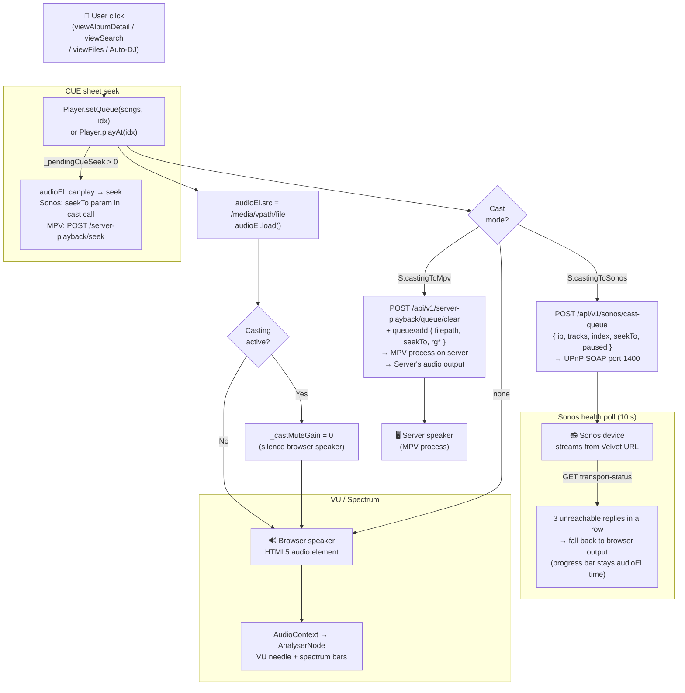
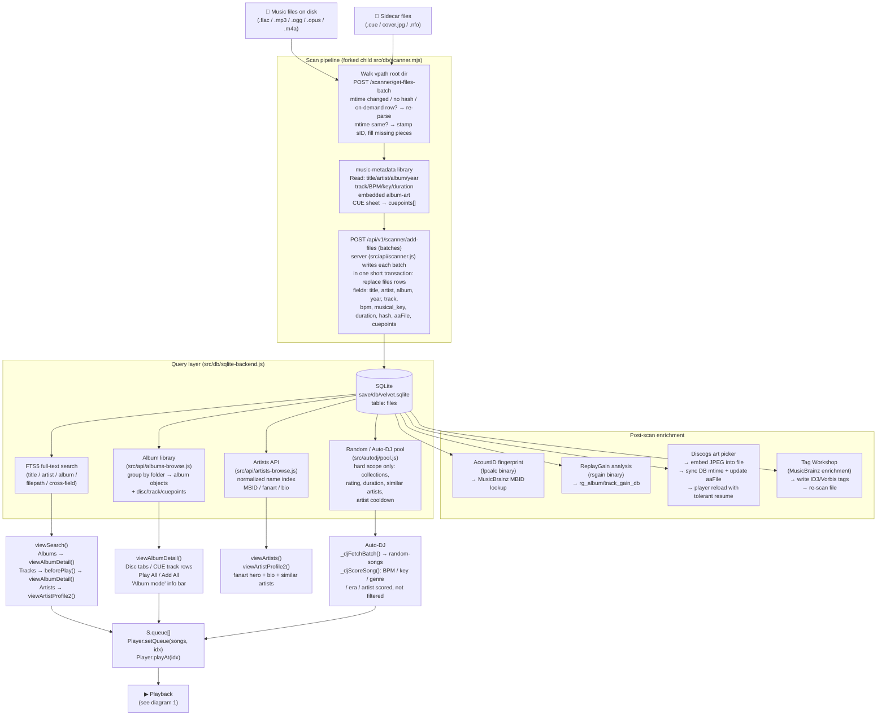
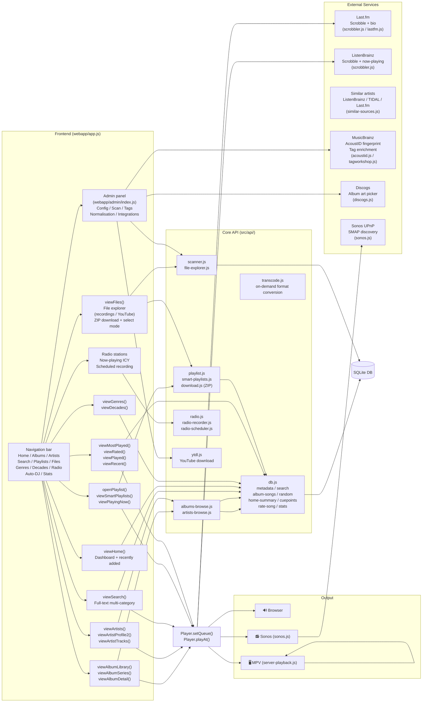
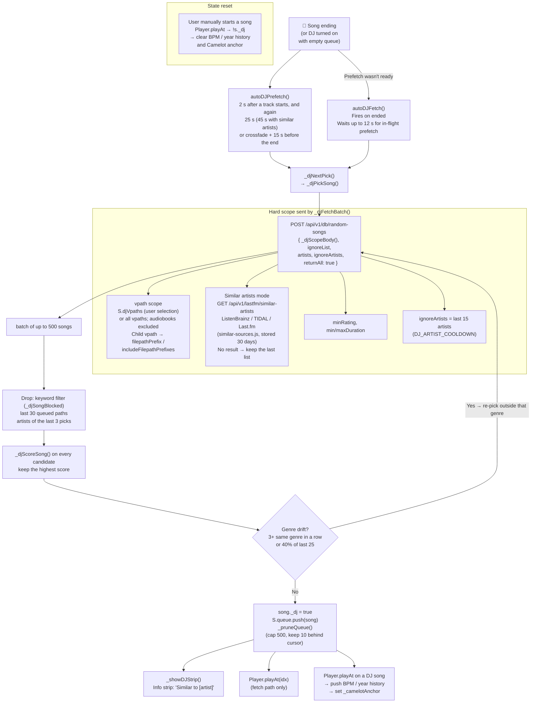
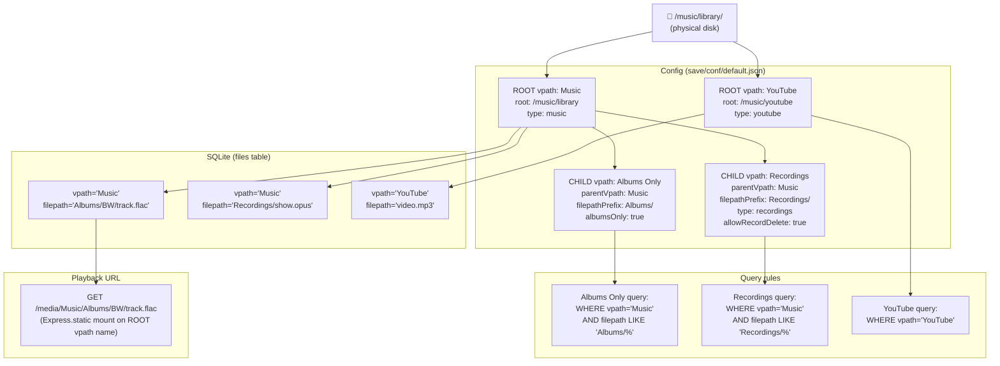
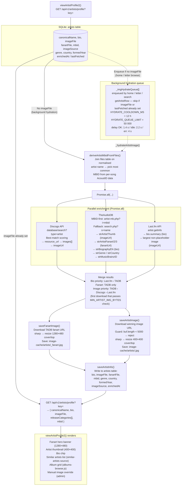

# Velvet — Architecture Diagrams

Paste any diagram block into [mermaid.live](https://mermaid.live) to view / export as SVG or PNG.

---

## 0. Module structure

Velvet is one Node.js process (ESM, Express 5, `node:sqlite`). `src/server.js` loads the config, opens the database,
mounts the web apps and calls `setup(velvet)` on every API module.

| Folder | What lives there |
|---|---|
| `src/api/` | One file per feature area. Each exports `setup(velvet)` and registers its Express routes (`/api/v1/...`, Subsonic `/rest/*` in `subsonic.js`, DLNA in `dlna.js`). Routes are listed in [API.md](API.md). |
| `src/db/` | The database layer. `manager.js` is the only entry point: every other module imports `* as db from '../db/manager.js'`. `sqlite-backend.js` holds the SQL and is imported only by `src/db/`. Also here: `scanner.mjs` (the scan, run as a forked child process by `task-queue.js`), `sql-clauses.js` (shared WHERE helpers), `album-art-select.js`, `wrapped-stats.mjs`, and the image-compress child process. |
| `src/state/` | Process-wide state: `config.js` (Joi schema + live config), `scan-lock.js` (pauses workers while a scan runs), `bg-task-broker.js` (serialises main-thread DB-writing background tasks), `scan-progress.js`, `lastfm.js`, `shutdown.js` (ordered shutdown hooks: services, then HTTP, then DB). |
| `src/util/` | Shared helpers (path security, SSRF checks, vpath logic, auth, validation, ffmpeg/fpcalc/rsgain bootstrap) and the worker-thread scripts (`*-worker.mjs`). |
| `src/autodj/` | Server-side Auto-DJ: `scoring.js` (server copy of the browser scoring, kept in step by `test/autodj-parity.test.mjs`), `pool.js` (candidate pool, shared with `POST /api/v1/db/random-songs`), `radio.js` (radio chain), `library.js` (wires the chain to the DB, the similar-artists source and user prefs). Used by Rooms, Subsonic similar songs and `POST /api/v1/autodj/next`. |
| `src/sendspin/` | Velvet Rooms (Sendspin protocol): rooms, scheduler, audio pipeline, per-room EQ, pairing and trust store, mDNS discovery, Sonos followers. Routes in `src/api/sendspin.js`. See [rooms.md](rooms.md). |
| `src/smartplaylist/` | ML smart playlists (feature extraction, generator, routes), behind `BETA_SMART_PLAYLIST` in `src/beta-flags.js`. |

**Worker threads.** Long-running library jobs run in `node:worker_threads` workers hosted by
`createWorkerController()` in `src/util/worker-controller.js`: AcoustID (`acoustid-worker.mjs`), ReplayGain
(`rg-analysis-worker.mjs`), MusicBrainz enrichment and text search (`mb-enrich-worker.mjs`,
`mb-text-search-worker.mjs`), BPM/key (`ab-bpm-worker.mjs`, `essentia-bpm-worker.mjs`) and genre enrichment
(`genre-enricher-worker.mjs`). The controller handles start/stop, crash restart (a worker restarted while a scan runs starts paused), pause
during a scan, a staggered auto-start after each scan and the `workerAutostart` config flags. A worker that reports a
fatal error (for example AcoustID with a missing or invalid API key) is stopped for good: no crash restart, and its
auto-start flag is turned off. The artist-index rebuild
(`artist-rebuild-worker.mjs`) is started from `src/db/sqlite-backend.js`.

**Web apps** (`webapp/`, served statically):

| Path | App |
|---|---|
| `index.html` + `app.js` | Main player (single-page app) |
| `admin/` | Admin panel (Vue 2, `admin/index.js`) |
| `mobile/` | Mobile PWA |
| `tizen/` | Samsung TV app |
| `remote/` | Jukebox remote page (`/remote/:code`) |
| `server-remote/` | Remote for Server Audio (MPV) |
| `shared/` | Shared-playlist page |
| `qr/` | QR code page |
| `locales/` | i18n files (12 languages) |

Static rules about this structure (DB boundary, routes documented, no duplicate functions, and more) are enforced by
the architecture guard tests: see [dev/architecture-guards.md](dev/architecture-guards.md).

---

## 1. Playback Pipeline

How a song gets from storage to speaker in the web player — three output paths. Velvet Rooms are a fourth: the
server plays the queue itself (`src/sendspin/`), see [rooms.md](rooms.md).

---

## 2. Scan → Index → Play Data Flow

How files go from disk to the queue.

---

## 3. Feature Modules Map

All major subsystems and which API routes / frontend views they connect.

---

## 4. Auto-DJ System

How Auto-DJ selects, filters, and queues the next track.

### Scoring engine

`_djFetchBatch()` makes one `POST /api/v1/db/random-songs` request with
`returnAll: true`. The server (`src/autodj/pool.js`) applies only the hard
scope — selected collections, minimum rating, track-length window, audiobook
exclusions, the similar-artist list and the artist cooldown — and returns a
batch of up to 500 songs. `_djPickSong()` drops keyword-blocked songs, songs in
the last 30 of the queue and (when possible) artists from the last 3 picks,
then scores every candidate with `_djScoreSong()` and keeps the best.

Weights: similar-artist (source rank) 35%, BPM proximity 25%, genre 13%,
harmonic (Camelot) fit 7%, year/era proximity 10%, artist diversity 10%.
Without similar-artist data the 35% is spread over BPM, genre and harmonic.
BPM, key and genre are scored, never filtered. Full details:
[autodj-scoring.md](autodj-scoring.md).

The BPM and year anchors are the average of the last 8 DJ-picked songs; a
manually started song clears them, so switching Auto-DJ on mid-playback does
not lock the session to an unrelated tempo. A genre-drift guard re-picks when
one genre runs 3+ times in a row or fills 40% of the last 25 picks.

The same scoring runs on the server in `src/autodj/` (`scoring.js` is a copy
of the browser code, checked by `test/autodj-parity.test.mjs`). The server
uses it for Velvet Rooms, for Subsonic similar songs, and for
`POST /api/v1/autodj/next`, which the Tizen TV app and the Server Audio remote
call instead of running their own Auto-DJ — see `docs/tizen-tv.md`.

---

## 5. vpath Hierarchy

How virtual paths are configured and how files are stored vs. queried.

### Media route authorization

- Raw media URLs are now authorized by vpath before static-file serving.
- Requests to unknown or unauthorized libraries return `404` (not `403`) so inaccessible library names are not disclosed.
- Authenticated users can only stream from vpaths in `req.user.vpaths`; no-user mode still allows all configured vpaths.

---

## Diagram 6 — Artist Enrichment Pipeline

How artist metadata and images are fetched from external services and stored.

---

## Diagram 7 — Album Library + CUE Sheet Handling

How albums are built from the database and CUE-sheet tracks are expanded.

```mermaid
flowchart TD
    subgraph "Config: vpath declarations"
        VP1["albumsOnly: true\n(root vpath — all files)"]
        VP2["albumsOnly: true\n(child vpath — filepathPrefix='Albums/')"]
        VP3["fallback: any root with Albums/ subdir on disk"]
    end

    VP1 & VP2 & VP3 --> RESOLVE

    RESOLVE["resolveAlbumsSources()\nReturns source[] each with:\nvpathName, dbVpath, prefix,\nvpathRoot, artRoot\n(cached; invalidated on scan)"]

    RESOLVE --> DBQUERY

    DBQUERY["DB query per source\nWHERE vpath=dbVpath\n[AND filepath LIKE prefix+'%']\nReturns rows: filepath, title, artist,\nalbum, track, disk, year, duration,\naaFile, cover_file, cuepoints"]

    DBQUERY --> BUILDTREE

    subgraph "buildTreeFromDB(rows, source) — BOTTOM-UP"
        direction TB
        BUILDTREE["Strip source.prefix from filepath\nFor each file: look backwards from filename"]
        BUILDTREE --> DISCCHECK
        DISCCHECK{"Immediate parent\n= disc folder?\n(CD1, Disc 2, …)"}
        DISCCHECK -->|"Yes"| DISCALBUM["album = grandparent folder\ndisc = immediate parent\n(any depth — e.g. Genre/Artist/Album/CD1/track)"]
        DISCCHECK -->|"No"| FLATALBUM["album = immediate parent folder\n(any depth — e.g. Genre/Artist/Album/track)"]
        DISCALBUM & FLATALBUM --> ARTIST["artist = one folder above album\n(Genre/Artist → artist='Artist')\nEverything above is display context only"]
        ARTIST --> GROUPALBUM["Group by albumPath\nGroup by artistPath → series\n(multiple albums under same artist folder)"]
        GROUPALBUM --> ALBUM1["Single album under artist\n→ standalone album"]
        GROUPALBUM --> SERIES["Multiple albums under artist\n→ Series + per-album cards\nbuildAlbumFromData() × N"]
    end

    ALBUM1 & SERIES --> TRACKLIST

    subgraph "buildTrackListFromEntries()"
        TRACKLIST["Sort by track number → filename\nPer track:\n  filepath = dbVpath + '/' + row.filepath\n  title, artist, number, duration, aaFile\n  cuepoints: JSON.parse(row.cuepoints)\n  (only if length >= 2)"]
    end

    TRACKLIST --> ARTRESOLVE

    subgraph "resolveArt(albums, series)"
        ARTRESOLVE["Series art: first member with aaFile/artFile\n(zero FS calls)\nStandalone albums: parallel fsp.access()\ncheck ART_NAMES (cover.jpg, front.jpg, …)\nDisc sub-folder fallback if no root art"]
    end

    ARTRESOLVE --> CACHE["_cache (slim browse)\n_cacheFull Map<albumId, fullAlbum>\nTTL: 5 min"]

    CACHE --> BROWSE["GET /api/v1/albums/browse\n→ { albums[], series[] }\n(no disc detail — lazy)"]
    CACHE --> DETAIL["GET /api/v1/albums/detail?id=\n→ full album with discs[]\nEach disc has tracks[]\nEach track may have cuepoints[]"]

    DETAIL --> CLIENT["viewAlbumDetail() renders:\nAlbum art header\nDisc tabs (multi-disc)\nTrack rows\n  — if cuepoints ≥ 2: expand\n    each cuepoint as a sub-row\n    with title/timestamp\nPlay All / Add All buttons\n'Album mode' info bar"]

    subgraph "CUE sheet: scan time"
        CUE_SCAN["Scanner reads sidecar .cue or\nembedded CUESHEET vorbis tag\nvia music-metadata\n→ cuepoints[] stored as JSON\nin files.cuepoints column\n(NULL until scanned; [] = probed+empty)"]
    end

    subgraph "CUE sheet: play time"
        CUE_SELECT["Track selected in album view\n→ _cueSeek = cuepoint.timestamp (s)\nSeek bar: tick marks at each cuepoint\n(clickable — seeks + highlights row)"]
        CUE_WEB["🌐 Web browser\naudioEl: canplay event\n→ audioEl.currentTime = _cueSeek"]
        CUE_SONOS["📻 Sonos\nseekTo: Math.floor(_cueSeek)\npassed in POST /api/v1/sonos/cast\n→ UPnP SOAP SetAVTransportURI"]
        CUE_MPV["🖥️ MPV\nPOST /api/v1/server-playback/seek\n{ position: _cueSeek }"]
        CUE_SELECT --> CUE_WEB & CUE_SONOS & CUE_MPV
    end

    CUE_SCAN -.->|"cuepoints[] in DB"| TRACKLIST
    CLIENT -.->|"User selects CUE track"| CUE_SELECT
```

